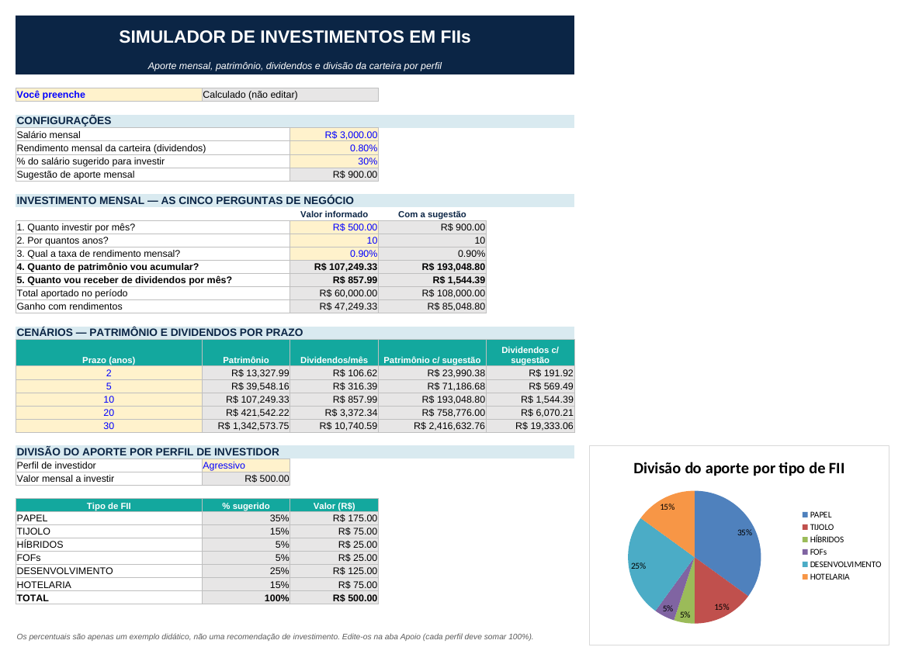

# Simulador de Investimentos em FIIs (Excel)

Ferramenta em Excel que simula investimentos mensais em **fundos imobiliários (FIIs)**: do aporte de cada mês até os dividendos que o patrimônio rende. Ela também projeta o patrimônio em cenários de 2 a 30 anos e divide o aporte entre seis tipos de FII, conforme o perfil de investidor escolhido numa lista. Quem usa não precisa saber nenhuma fórmula: basta preencher as células amarelas.

Projeto do Desafio **"Criando uma Ferramenta de Controle de Investimentos com Excel"**, do Bootcamp **Santander – Excel com IA e Claude**, da [DIO](https://www.dio.me/).

📥 **Arquivo:** [`simulador_investimentos_fii.xlsx`](simulador_investimentos_fii.xlsx)

## A ferramenta funcionando: mesma simulação, dois perfis

Simulação: aporte de **R$ 500/mês** durante **10 anos** a **0,90% ao mês**. Só o perfil muda.

**Perfil Moderado**


**Perfil Agressivo**



Repare que patrimônio, dividendos e cenários continuam iguais. O que muda é a **divisão do aporte** entre os tipos de FII, na tabela e no gráfico de pizza.

## As perguntas que a ferramenta responde, e onde

Todas ficam na aba **Simulador**, no bloco "Investimento mensal — as cinco perguntas de negócio".

| # | Pergunta | Onde aparece | Como é obtida |
|---|---|---|---|
| 1 | Quanto investir por mês? | `D15` | Você informa (célula amarela) |
| 2 | Por quantos anos? | `D16` | Você informa |
| 3 | Qual a taxa de rendimento mensal? | `D17` | Você informa |
| 4 | Quanto de patrimônio vou acumular? | `D18` | Calculado com `VF` |
| 5 | Quanto vou receber de dividendos por mês? | `D19` | Patrimônio × rendimento da carteira |

Na coluna **E**, as mesmas respostas são recalculadas usando a **sugestão de 30% do salário** no lugar do valor informado. Logo abaixo, a planilha mostra também o total aportado e o ganho com rendimentos.

## Como o VF e o PROCV entram nos cálculos

### VF: patrimônio acumulado

```
=VF(taxa_mensal; qtd_anos*12; -aporte)
```

| Argumento | O que significa aqui |
|---|---|
| `taxa_mensal` | Taxa de rendimento de cada mês (ex.: 0,90%) |
| `qtd_anos*12` | Número de meses, porque os aportes são mensais |
| `-aporte` | O valor investido por mês, com sinal **negativo** porque é dinheiro que sai do seu bolso; assim o resultado (patrimônio) sai positivo |

Os dividendos mensais vêm do patrimônio: `=patrimonio*rendimento_carteira`.

Nos **cenários** (2, 5, 10, 20 e 30 anos), a fórmula usa o prazo da própria linha com referência mista, para não se perder ao arrastar:

```
=VF(taxa_mensal; $B25*12; -aporte)
```

### PROCV com chave composta: percentual de cada tipo de FII

A aba **Apoio** tem uma coluna **CHAVE** que junta perfil e tipo de fundo: `=B5&"-"&C5`, que vira, por exemplo, `Moderado-TIJOLO`. No Simulador, o percentual de cada tipo é buscado montando a mesma chave:

```
=PROCV(perfil&"-"&$B36; Apoio!$A:$D; 4; FALSO)
```

Assim, um único PROCV acha o percentual certo para **qualquer combinação** de perfil e tipo. O valor em reais é o percentual × aporte mensal.

## Intervalos nomeados

| Nome | Célula | Conteúdo |
|---|---|---|
| `salario` | Simulador!D8 | Salário mensal |
| `rendimento_carteira` | Simulador!D9 | Rendimento mensal da carteira (dividendos) |
| `pct_sugestao` | Simulador!D10 | % do salário sugerido para investir (30%) |
| `sugestao_aporte` | Simulador!D11 | Sugestão de aporte (`=salario*pct_sugestao`) |
| `aporte` | Simulador!D15 | Quanto investir por mês |
| `qtd_anos` | Simulador!D16 | Por quantos anos |
| `taxa_mensal` | Simulador!D17 | Taxa de rendimento mensal |
| `patrimonio` | Simulador!D18 | Patrimônio acumulado |
| `perfil` | Simulador!C32 | Perfil escolhido na lista |

## Percentuais de cada perfil, e de onde vieram

| Tipo de FII | Conservador | Moderado | Agressivo |
|---|---:|---:|---:|
| PAPEL | 25% | 30% | 35% |
| TIJOLO | 45% | 30% | 15% |
| HÍBRIDOS | 15% | 10% | 5% |
| FOFs | 15% | 10% | 5% |
| DESENVOLVIMENTO | 0% | 10% | 25% |
| HOTELARIA | 0% | 10% | 15% |
| **Total** | **100%** | **100%** | **100%** |

São percentuais **criados por mim como exemplo didático**, com uma lógica simples de risco: o perfil conservador concentra em fundos de tijolo e de papel, de renda mais previsível, e não usa desenvolvimento nem hotelaria; o agressivo aceita mais risco nesses segmentos em troca de potencial de retorno maior. **Não são recomendação de investimento.**

A aba Apoio confere sozinha se cada perfil soma 100% (`SOMASE` + `SE`) e mostra "OK" ou "Ajustar".

## O que mudei em relação à ferramenta do Expert

- **Simulação comparativa:** a coluna "Com a sugestão" e duas colunas extras nos cenários repetem tudo usando 30% do salário no lugar do aporte informado.
- **Percentual da sugestão editável:** os 30% ficam numa célula própria (`pct_sugestao`), em vez de fixos na fórmula.
- **Total aportado e ganho com rendimentos:** mostram quanto do patrimônio é dinheiro investido e quanto é rendimento.
- **Gráfico de pizza** com a divisão do aporte, que muda junto com o perfil.
- **Conferência automática** de que cada perfil soma 100%.
- **Legenda de cores:** amarelo para o que você preenche, cinza para o que é calculado.
- **Validação com mensagem de erro** na lista de perfis.
- **Títulos de linhas e colunas ocultos** na aba Simulador, para ficar com cara de aplicativo.
- **Percentuais e valores de exemplo próprios**, diferentes dos usados nas aulas.

## Como usar

1. Baixe o arquivo [`simulador_investimentos_fii.xlsx`](simulador_investimentos_fii.xlsx) e abra no Excel.
2. Preencha apenas as **células amarelas**: salário, rendimento da carteira, quanto investir, por quantos anos e a taxa mensal.
3. Escolha o **perfil de investidor** na lista.
4. Para mudar a divisão entre os tipos de FII, edite a coluna **%** na aba **Apoio**, mantendo cada perfil em 100%.

> Para a versão final com cara de aplicativo, você também pode esconder a barra de fórmulas e as guias no próprio Excel (menu **Exibir**). Essas opções são do Excel, não do arquivo.

## Aviso

O salário, as taxas e os percentuais do arquivo são **valores de exemplo**, apenas para fins de estudo.

## Autor

**Álvaro Machado Júnior**: professor de Informática.
<!-- Adicione aqui o link do seu LinkedIn e do seu perfil na DIO -->
