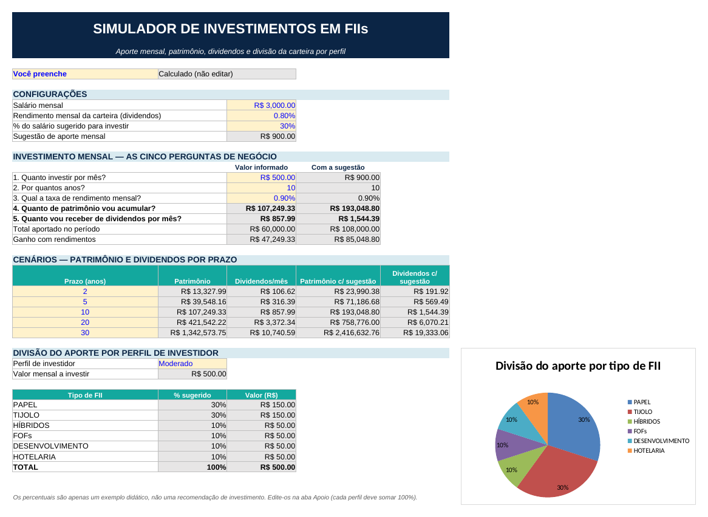

# Simulador de Investimentos em FIIs (Excel)

Ferramenta em Excel que simula investimentos mensais em **fundos imobiliários (FIIs)**: do aporte de cada mês até os dividendos que o patrimônio rende. A planilha também projeta cenários de 2 a 30 anos e divide o aporte entre seis tipos de FII, conforme o perfil de investidor escolhido.

Projeto desenvolvido no Desafio de Projeto **"Criando uma Ferramenta de Controle de Investimentos com Excel"** do Bootcamp **Santander – Excel com IA e Claude**, da [DIO](https://www.dio.me/).



## Perguntas de negócio respondidas

| # | Pergunta | Como a planilha responde |
|---|---|---|
| 1 | Quanto investir por mês? | Valor informado (célula amarela) |
| 2 | Por quantos anos? | Valor informado |
| 3 | Qual a taxa de rendimento mensal? | Valor informado |
| 4 | Quanto de patrimônio vou acumular? | `=VF(taxa_mensal; qtd_anos*12; -aporte)` |
| 5 | Quanto vou receber de dividendos por mês? | `=patrimonio*rendimento_carteira` |

## O que a ferramenta tem

- **Visual de aplicativo**: banner, linhas de grade e títulos ocultos, células de entrada em amarelo e células calculadas em cinza (não editar).
- **Configurações**: salário, rendimento mensal da carteira e a sugestão de aporte de 30% do salário (o percentual também é editável).
- **Cenários de 2, 5, 10, 20 e 30 anos**, com referências absolutas para a fórmula não se perder ao arrastar.
- **Comparativo**: a mesma simulação usando a sugestão de 30% do salário no lugar do aporte informado.
- **Intervalos nomeados** no lugar de endereços de célula: `salario`, `rendimento_carteira`, `pct_sugestao`, `sugestao_aporte`, `aporte`, `qtd_anos`, `taxa_mensal`, `patrimonio`, `perfil`.
- **Divisão por perfil** (Conservador, Moderado, Agressivo), escolhido numa lista com validação de dados. Cada percentual vem da aba **Apoio** por `PROCV` com chave composta (`perfil&"-"&tipo`).
- **Gráfico de pizza** com a divisão do aporte, que muda junto com o perfil.
- **Conferência automática** na aba Apoio: cada perfil precisa somar 100% (status "OK" ou "Ajustar").

## Funções e recursos de Excel usados

`VF` · `PROCV` · `SOMA` · `SOMASE` · `SE` · `ARRED` · concatenação com `&` · intervalos nomeados · validação de dados (lista) · referências absolutas e mistas · gráfico de pizza · formatação de moeda e porcentagem.

## Como usar

1. Baixe o arquivo [`simulador_investimentos_fii.xlsx`](simulador_investimentos_fii.xlsx) e abra no Excel.
2. Preencha apenas as **células amarelas**: salário, rendimento da carteira, quanto investir, por quantos anos e a taxa mensal.
3. Escolha o **perfil de investidor** na lista.
4. Para mudar a divisão entre os tipos de FII, edite a coluna **%** na aba **Apoio**, mantendo cada perfil em 100%.

## Estrutura do repositório

```
simulador-investimentos-fii/
├── simulador_investimentos_fii.xlsx   # a ferramenta
├── assets/preview.png                 # imagem de prévia
└── README.md
```

## Aviso

Os percentuais por perfil e as taxas usadas são **apenas exemplos didáticos**, não recomendação de investimento.

## Autor

**Álvaro Machado Júnior**: professor de Informática.
<!-- Adicione aqui o link do seu LinkedIn e do seu perfil na DIO -->
